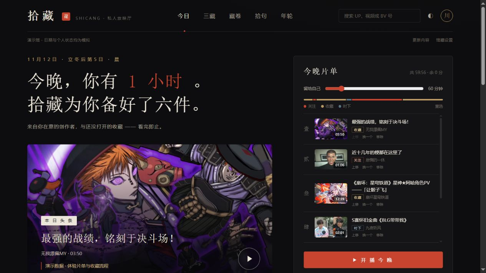
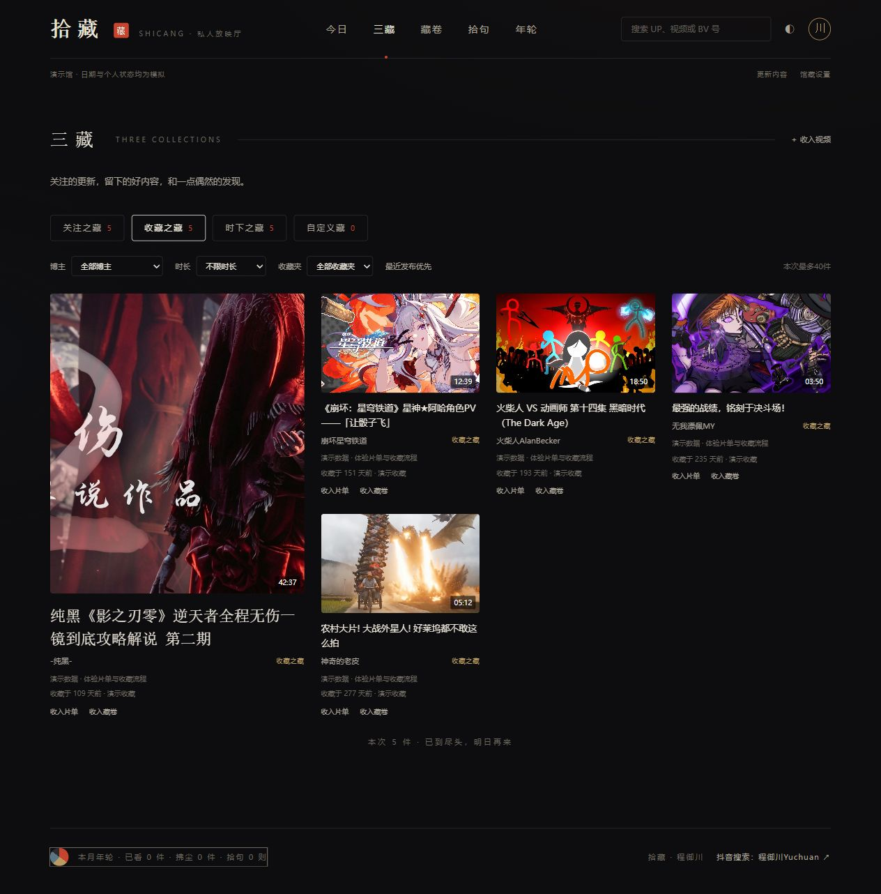
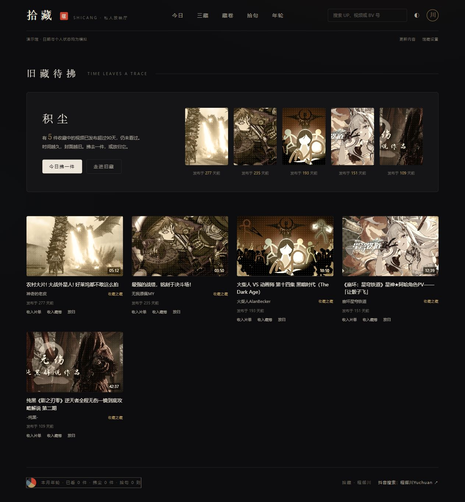

# 拾藏 · Picked Space

把关注和收藏，变成真正会打开的私人视频馆。

作者：**程御川** · 记录AI怎样改变工作与生活。[抖音搜索：程御川Yuchuan](https://www.douyin.com/search/%E7%A8%8B%E5%BE%A1%E5%B7%9DYuchuan)。

**v1.0.1 新版已加入仓库，代码在 `shicang-next/`。** 这是视频中深墨底、宋体标题、朱砂强调色的新版私人放映厅。旧版源文件仍保留，v0.7.0发行版和使用记录不受影响。

## 看看拾藏

**以下截图全部来自公开演示馆，不展示我的真实关注、收藏、观看记录或笔记。**

### 今日：先给自己一点时间

左边是一条想打开的内容，右边是一份能看完的片单。自动选片尽量贴近预算；手动加进来的视频可以超过预算。



### 三藏：把不同来源放在同一个馆里

关注更新、收藏与稍后再看、时下内容和手动收入都能在这里找；按博主、时长、收藏夹筛选，不靠无限下滑找下一条。



### 积尘：让没打开的旧藏重新被看见

封面随视频发布年限逐渐做旧，点“今日拂一件”重新收入片单。这里判断的是**视频发布超过90天**，不是收藏满90天。



以上为v1.0.1实际运行的**公开演示馆**截图（2026-11-12）。视频来自公开元数据，日期、关注和收藏状态均为模拟，不展示作者的个人库；封面版权归原作者。[截图说明](docs/screenshots/README.md)。

## 先运行起来

需要 **Node.js 24.5 或以上**。在终端运行：

```sh
git clone https://github.com/CHENGHAO9527/picked-space.git
cd picked-space
npm ci --prefix shicang-next
npm run dev
```

打开 http://127.0.0.1:4180/ 。首次默认进入明确标注的演示馆，不需要登录，也不包含作者的账号、关注名单、收藏、观看记录或笔记。

长期运行使用 `npm run build`、`npm start`。Windows安装依赖后也可双击根目录的“启动拾藏.cmd”，或新版目录的“启动拾藏新版.cmd”。程序只监听本机，不是多人注册网站或在线托管服务。

## 新版有什么

- **今晚片单**：先选30分钟到4小时，再组合一份有限片单。自动选片不超预算；你手动收入的视频尊重你的选择，可以超过预算。
- **三藏**：实际关注UP的近期投稿、收藏与稍后再看、时下前十，以及手动收入。支持UP分级与筛选，内容有边界，不无限下滑。
- **积尘**：已收藏/稍后再看、发布超过90天、且本地未看完的视频，以做旧封面提醒重新打开。不是按收藏日期计算，未知发布日期不猜。
- **时间河**：近七日关注更新的时间轴。
- **边看边逛**：原生页内播放、续播和右下小窗；官方嵌入可选备用，不自动跳回原站。
- **拾句与藏卷**：在实际播放时间记本地笔记，跨来源做主题合集并导出分享长图。
- **年轮**：本地月度观看分区、常看UP、拂尘和拾句记录；深色/宣纸浅色切换。

选片与分级是本地规则和你的偏好，不是网站在后台调用AI评分或自动理解兴趣。

## 换成你自己的内容

两种方式可选：

1. **让你自己的AI整理，再导入JSON。** 在自己的浏览器登录B站，授权有浏览器操作能力的AI读取实际关注名单和已确认公开的视频元数据。按[新版AI导入约定](shicang-next/AI_IMPORT.md)输出JSON，再执行：

   ```sh
   npm --prefix shicang-next run import:legacy -- /完整路径/我的公开内容.json
   ```

   在 `shicang-next/.env.local` 设 `USE_MOCK=false`，重启后读取你的本地快照。已有快照需要加 `--replace`，程序会先备份；观看状态和笔记不会因此清除。

2. **你本人配置服务端Cookie后点“更新内容”。** 复制新版 `.env.example` 为 `.env.local`，设 `USE_MOCK=false`，只在自己的本机填写 `BILI_COOKIE`。Cookie不要发到聊天、截图分享或提交Git。详见[新版README](shicang-next/README.md)。未配置Cookie也可使用导入的快照及更新公开榜单。

真正的关注名单必须单独读取，不能拿收藏视频作者推算；读取失败不等于停更。默认不读取私密收藏夹，额外排除名单由每个人自己在本机配置。不要把自己的完整工作目录直接上传到GitHub。

## 让AI做成你的版本

把本仓库和你的实际使用问题交给自己的AI，例如：

> 我想让晚上30分钟的片单更偏纪录片，保留一件没看过的旧收藏。先读shicang-next/AGENTS.md，解释现有规则，再帮我改，不改我的B站关注和收藏关系。

先用起来，再提出具体问题；不需要注册统一账号或购买内置AI额度。详见[复用指南](FORK_GUIDE.md)。

## 播放与数据边界

- 视频仍来自B站网络资源，不是离线视频库；登录专属、付费、试看或无法取得完整流的内容不保证播放，也不保证全部1080p。
- 本地原生播放器可以读取真实进度与结束事件；跨域官方嵌入无法读取进度/结束，需手动输入笔记时间和点下一件。
- 账号接口可能变化、限流或要求验证，验证由使用者本人在原站处理。代码已接入限速、缓存和WBI签名，不等于登录后所有同步路径已经实测。
- “放归”只隐藏本地内容并二次确认，不修改B站的收藏或关注。观看、片单、笔记、缓存只在你的 `.local/` SQLite库中保存。
- 演示馆使用15条公开榜单元数据，日期/收藏/关注状态明确为模拟，不代表作者个人偏好或真实推荐。

## 开发与验证

```sh
npm test
npm run typecheck
npm run build
npm run package:template
```

根目录命令默认转发新版。`npm test`同时检查旧版兼容模块与新版规则；CI在Linux和Windows执行安装、测试、类型和构建。数据、导入与播放边界见[TEMPLATE_QA.md](TEMPLATE_QA.md)。

旧实现可用 `npm run start:legacy` 在4173端口独立运行；[旧版说明](docs/legacy-v0.7-README.md)和[v0.7.0发行版](https://github.com/CHENGHAO9527/picked-space/releases/tag/v0.7.0)保留。新版不会自动读取浏览器中的旧版数据，也不会随仓库带走作者的个人库。

## 关于作者

我是**程御川**，外企数据工程师，也是三岁娃的爸爸。我在记录AI怎样改变工作与生活：从自己的实际问题出发，把工具做出来、用起来，再分享过程和踩过的坑。拾藏就是其中一个自己做、自己用、边用边改的小项目。

**[在抖音搜索「程御川Yuchuan」](https://www.douyin.com/search/%E7%A8%8B%E5%BE%A1%E5%B7%9DYuchuan)**，可以看到更多AI实践和个人项目记录。欢迎把你的使用体验和想改的功能带回来，一起把工具改得更顺手。

仓库只包含网页代码、网页截图、使用说明和作者信息；视频及发布材料不在仓库或发行包中。

另一个自己做、自己用的项目：[胶囊衣橱](https://github.com/CHENGHAO9527/capsule-wardrobe)，用已有衣服安排今日穿搭、旅行行李和购前比较。

## 许可

[MIT License](LICENSE)。视频、封面和平台商标归原权利人，本项目与哔哩哔哩无官方关联。依赖版本已固定在新版package.json与package-lock.json中。
