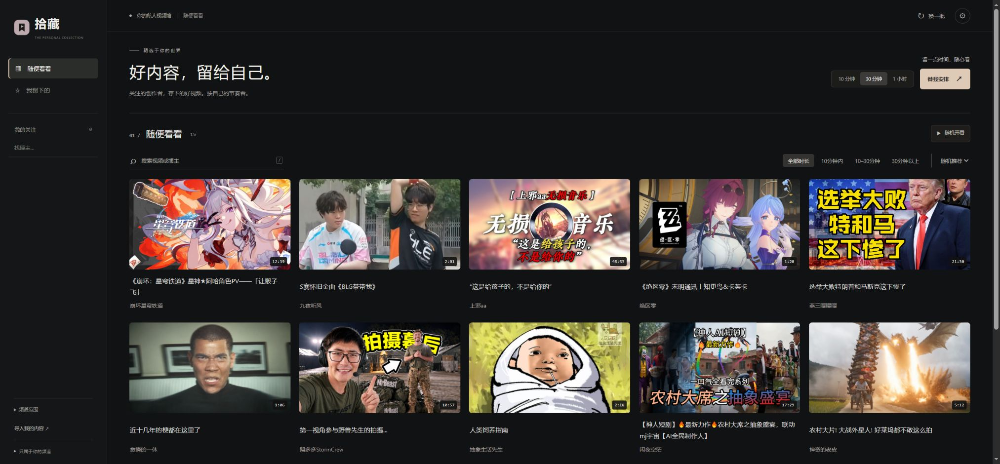

# 拾藏 · Picked Space

**把关注和收藏，变成真正会打开的私人视频馆。**

拾藏是一个运行在自己电脑上的 B 站视频空间。把你关注博主的作品、收藏、稍后再看和可选榜单放到一起，在自己的页面浏览、预览和播放。



## 它能做什么

- **边看边逛**：视频收进右下角小播放器，搜索和切换博主时不中断，展开不重置进度。
- **封面快照预览**：鼠标停留后轮播真实视频快照，横向移动查看不同位置；无声、不抢占播放器。
- **私人放映单**：给自己10、30或60分钟，安排一组未看完的视频；按标注时长控制总长度，同组博主不重复。
- **混合浏览**：关注、收藏、稍后再看和榜单按BV去重，不必在不同列表里来回找。
- **自己的节奏**：按博主、时长和关键词筛选，记录续播、笔记和喜欢的视频，隐藏长期停更的频道。
- **交给自己的AI定制**：设置观看偏好，导出自己的需求说明，让你使用的AI继续改造这个项目。

## 快速启动

需要 [Node.js 24.5 或以上](https://nodejs.org/)。无需安装 npm 依赖。

```sh
git clone https://github.com/CHENGHAO9527/picked-space.git
cd picked-space
npm start
```

打开终端显示的地址，默认 [http://127.0.0.1:4173/](http://127.0.0.1:4173/)。Windows也可解压源码后双击 `启动拾藏.cmd`。本版需要Node本地服务，不能直接双击HTML或只部署静态文件。

## 用你自己的内容建立频道

1. 首次打开是空频道，点击“设置我的频道”，设置名称与观看偏好。
2. 在B站登录你自己的账号，从网站“如何更新内容”复制导入提示词，交给有浏览器操作能力的AI。
3. AI按你授权的范围读取真实关注名单和公开视频，整理成JSON；登录、验证码等本人验证由你完成。
4. 点击“导入内容”→“检查数据”→“确认合并导入”，以后可以增量导入。

模板不含作者的账号、关注名单、收藏库、私密排除策略或登录凭证。示例需主动点击才显示。页面截图使用公开榜单元数据演示，**不代表作者的关注或收藏**。

详细教程见 [建立自己的频道](FORK_GUIDE.md)；数据格式见 [AI导入约定](AI_IMPORT.md)。

## 加入自己的需求

已有开关可直接修改：桌面4/5列、悬停预览、混入榜单、隐藏已看，以及停更时间。

更个性化的需求可以填入“我还希望这个网站怎样为我服务”，下载 `我的拾藏需求.md`，连同项目交给自己的AI。兴趣和自然语言要求目前只是定制说明，**不会自动调用AI或改变推荐**。

每个人运行自己的本地副本。本项目尚不是一个统一托管、多人登录的在线平台。

## 播放与数据边界

- 视频通过网络读取公开视频流，不是离线视频库；原生播放器不自动跳转原站，清晰度按实际可取得的流显示。
- 需要登录、付费、仅提供试看或不支持格式的视频，可能无法在本站播放；不保证全部视频或1080p。
- 预览使用视频快照，缺少快照时保留封面，不把快照冒充完整视频。
- 不自动登录B站，不读取浏览器Cookie/Token文件，不内置付费AI调用，不自动同步账号。
- 停更规则只影响本站展示，不取消B站关注。来源、数量及未完成范围由实际导入记录决定。
- 数据与偏好默认在当前浏览器保存。请定期导出备份；续播位置目前不随备份迁移。

## 开发与验证

原生HTML/CSS/JavaScript＋Node内置模块，无构建步骤。

```sh
npm test
node scripts/package-template.mjs
```

打包文件保存在 `.local/releases/`，不进入Git历史。

公开副本不含个人库，因此个人快照相关测试会按设计跳过。GitHub Actions在Linux和Windows运行通用测试。

| 文件 | 职责 |
| --- | --- |
| `dist/app.mjs` | 界面、导入和播放器交互 |
| `dist/core.mjs` | 校验、去重、筛选和混排 |
| `dist/session.mjs` | 时间放映单 |
| `dist/settings.mjs` | 偏好与需求说明 |
| `dist/hover-preview.mjs` / `preview.mjs` | 快照预览 |
| `playback.mjs` / `server.mjs` | 本机播放服务 |
| `dist/layout.css` / `dist/style.css` | 布局与功能样式 |

分享自己的版本前，请使用打包脚本生成不含个人数据的模板；不要直接上传完整工作目录。开发约定见 [AGENTS.md](AGENTS.md)，验证清单见 [TEMPLATE_QA.md](TEMPLATE_QA.md)。

## 许可

代码使用 [MIT License](LICENSE)。视频、图片和平台商标归原权利人；项目与哔哩哔哩无官方关联。
